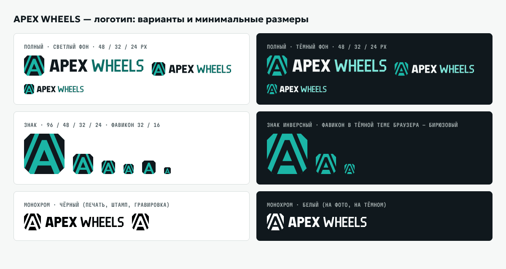

# APEX WHEELS: предложение по узнаваемому дизайну

**Статус:** это предложение для согласования с заказчиком (карточка T4, решение D1). Код витрины (`app/`, `components/`, `app/globals.css`) не менялся. Всё, что здесь описано, — концепция и статический прототип.

**Как посмотреть.** Откройте `prototype/index.html` в браузере: сборка не нужна, работает и как файл. Шрифты подключаются с Google Fonts, без интернета страница покажет системные шрифты.

| Файл | Что внутри |
|---|---|
| `prototype/index.html` | Главная: шапка, первый экран с подбором, сезоны, каталог (8 шин), «Как оформить заказ», блок магазина, футер, компактный cookie-баннер, корзина-диалог |
| `prototype/product.html` | Карточка товара: Pirelli Ice Zero FR 235/55 R18 |
| `prototype/components.html` | Палитра, типографика, логотип, компоненты и все состояния |
| `prototype/styles.css`, `prototype/proto.js` | Общие стили (токены в `:root`) и около 200 строк ванильного JS для демо: вкладки, фильтры, корзина, меню |
| `assets/logo/*.svg` | Логотип: полный, инверсный, монохром, знак, фавикон |
| `assets/tires/*.svg` | Иллюстрации шин T3, экспорт `pnpm images:tires docs/design-proposal/assets/tires` |
| `screens/*.png` | Скриншоты прототипа и сравнения «было/стало» |

Всё, что требует подтверждения заказчиком, помечено **[подтвердить]**. В прототипе такие места выделены жёлтыми плашками `[телефон]`, `[адрес]` и т. п.

---

## 1. Идея бренда

**Позиционирование одной фразой:** APEX WHEELS — магазин шин и дисков в Барнауле, где подбор начинается с цифр на боковине шины или с марки машины, а витрина учитывает сибирские сезоны.

**Идея «Язык маркировки».** Покупатель шин думает размерами: 225/45 R18, шипы или без шипов, XL, RunFlat. Бренд говорит на этом же языке, и это делает его узнаваемым без выдуманных обещаний:

- размеры, индексы и артикулы набраны отдельным моноширинным шрифтом и всегда стоят в «табличке маркировки»;
- на первом экране вместо постановочного фото показана схема «Размер — на боковине шины» с расшифровкой. Она сразу ведёт к подбору;
- на карточке товара маркировка расшифрована: 104 — до 900 кг на шину, H — до 210 км/ч (значения по стандартным таблицам индексов);
- сезоны оформлены как система: зима, межсезонье, лето. У каждого сезона свой цвет и свой значок, а не только подпись. Осенью первыми показываются зимние модели **[подтвердить правило сортировки]**.

Что сознательно **не** используем: награды, отзывы, рейтинги, «N лет на рынке», сроки доставки, гарантии и количество клиентов. В `config/business.ts` для них есть поля `marketing.*`, но значения не подтверждены. Когда заказчик их подтвердит, их можно вывести в отдельный блок.

---

## 2. Цвет: «Катунь» и палитра

**Сигнатурный цвет — бирюза «Катунь» `#1BB5A6`.** Название отсылает к бирюзовой воде алтайской реки Катунь. Цвет холодный и чистый: он ассоциируется со снегом и льдом, но не с «люксом». Его нет в типичном авто-шаблоне «чёрный + бежевый + золото», и он не совпадает с фирменными цветами крупных шинных брендов из каталога: Michelin (синий/жёлтый), Pirelli (жёлтый), Continental (оранжевый), Bridgestone (красный) **[подтвердить, что нет пересечения с брендами поставщиков]**.

Правило: бирюза — это заливка: основная кнопка, знак, полоса протектора, выбранный чип. Текст на ней всегда графитовый. Для текста и ссылок на светлом фоне используется затемнённая «Катунь глубокая» `#0B6E66`. Светлая тема основная. Тёмные секции (схема боковины, блок магазина, футер) — графит `#10181D`.

| Токен | HEX | Роль |
|---|---|---|
| `--ink` | `#10181D` | Графит: основной текст, тёмные секции, кольцо фокуса на светлом |
| `--ink-2` | `#1B262D` | Карточки на тёмном |
| `--slate` | `#4A5862` | Вторичный текст, служебные подписи |
| `--control` | `#73827E` | Границы полей, селектов, чипов (≥ 3:1) |
| `--disabled-text` | `#5C6B66` | Текст недоступных контролов |
| `--line` | `#D3DCD9` | Только декоративные разделители |
| `--frost` | `#E8EEEC` | Вторичная поверхность, сегменты, недоступные кнопки |
| `--snow` | `#F6F8F7` | Фон страницы (холодный белый вместо бежевой «бумаги») |
| `--white` | `#FFFFFF` | Карточки, поля |
| `--katun` | `#1BB5A6` | **Фирменный**: основная кнопка, знак, мотив |
| `--katun-hover` / `--katun-press` | `#4FD3C5` / `#17A698` | Состояния основной кнопки |
| `--katun-deep` | `#0B6E66` | Текст и ссылки на светлом |
| `--katun-tint` | `#D5F3EF` | Выбранный чип |
| `--katun-bright` | `#7FE6DA` | Акцентный текст и кольцо фокуса на тёмном |
| `--winter` / `--winter-tint` | `#1E4F8C` / `#E2ECF8` | Сезон «зима» |
| `--summer` / `--summer-tint` | `#8A4A00` / `#FCEBD3` | Сезон «лето» |
| `--allseason` / `--allseason-tint` | `#3D5A2A` / `#E6EEDC` | Всесезонные (межсезонье) |
| `--ok` / `--ok-tint` | `#17663A` / `#DFF3E6` | Успех |
| `--error` / `--error-tint` | `#B3261E` / `#FBE4E2` | Ошибка |
| `--warn` / `--warn-tint` | `#7A4E00` / `#FFF1CC` | Внимание, «демо-цена», плейсхолдеры `[подтвердить]` |
| `--on-dark` / `--on-dark-muted` | `#F6F8F7` / `#A9B7B4` | Текст на тёмном |

### Контраст по WCAG 2.x (рассчитано скриптом)

Значения посчитаны по формуле относительной яркости WCAG 2.x для токенов из `prototype/styles.css`. Обычный текст ≥ 4,5:1, крупный текст и границы контролов ≥ 3:1. Пар, не прошедших порог, нет: **0 из 29 обязательных пар**.

| Цвет (передний) | Фон | Контраст | Порог | Итог | Где используется |
|---|---|---|---|---|---|
| `--ink` #10181D | `--snow` #F6F8F7 | **16,82:1** | 4,5:1 | проходит | Основной текст на фоне страницы |
| `--ink` #10181D | `--white` #FFFFFF | **17,94:1** | 4,5:1 | проходит | Текст в карточках и полях |
| `--ink` #10181D | `--frost` #E8EEEC | **15,27:1** | 4,5:1 | проходит | Текст на вторичной поверхности |
| `--slate` #4A5862 | `--snow` #F6F8F7 | **6,88:1** | 4,5:1 | проходит | Вторичный текст на фоне |
| `--slate` #4A5862 | `--white` #FFFFFF | **7,33:1** | 4,5:1 | проходит | Вторичный текст в карточках, служебные подписи 12 px |
| `--slate` #4A5862 | `--frost` #E8EEEC | **6,24:1** | 4,5:1 | проходит | Подписи на вторичной поверхности |
| `--katun-deep` #0B6E66 | `--snow` #F6F8F7 | **5,73:1** | 4,5:1 | проходит | Ссылки, eyebrow-подписи |
| `--katun-deep` #0B6E66 | `--white` #FFFFFF | **6,11:1** | 4,5:1 | проходит | Ссылки в карточках |
| `--katun-deep` #0B6E66 | `--frost` #E8EEEC | **5,20:1** | 4,5:1 | проходит | Ссылки на вторичной поверхности |
| `--ink` #10181D | `--katun` #1BB5A6 | **7,01:1** | 4,5:1 | проходит | Текст основной кнопки |
| `--ink` #10181D | `--katun-hover` #4FD3C5 | **9,79:1** | 4,5:1 | проходит | Текст основной кнопки, hover |
| `--ink` #10181D | `--katun-press` #17A698 | **5,93:1** | 4,5:1 | проходит | Текст основной кнопки, нажатие |
| `--ink` #10181D | `--katun-tint` #D5F3EF | **15,29:1** | 4,5:1 | проходит | Текст выбранного чипа |
| `--winter` #1E4F8C | `--winter-tint` #E2ECF8 | **6,89:1** | 4,5:1 | проходит | Бейдж «Зимняя», 12 px |
| `--summer` #8A4A00 | `--summer-tint` #FCEBD3 | **5,87:1** | 4,5:1 | проходит | Бейдж «Летняя», 12 px |
| `--allseason` #3D5A2A | `--allseason-tint` #E6EEDC | **6,54:1** | 4,5:1 | проходит | Бейдж «Всесезонная», 12 px |
| `--on-dark` #F6F8F7 | `--ink` #10181D | **16,82:1** | 4,5:1 | проходит | Текст на тёмных секциях, бейдж «Шипы» |
| `--on-dark-muted` #A9B7B4 | `--ink` #10181D | **8,65:1** | 4,5:1 | проходит | Вторичный текст на тёмном |
| `--on-dark-muted` #A9B7B4 | `--ink-2` #1B262D | **7,43:1** | 4,5:1 | проходит | Вторичный текст на тёмной карточке |
| `--katun-bright` #7FE6DA | `--ink` #10181D | **12,16:1** | 4,5:1 | проходит | Акцентный текст на тёмном |
| `--ok` #17663A | `--ok-tint` #DFF3E6 | **6,04:1** | 4,5:1 | проходит | Сообщение об успехе |
| `--error` #B3261E | `--error-tint` #FBE4E2 | **5,38:1** | 4,5:1 | проходит | Сообщение об ошибке (плашка) |
| `--error` #B3261E | `--white` #FFFFFF | **6,54:1** | 4,5:1 | проходит | Текст ошибки под полем |
| `--warn` #7A4E00 | `--warn-tint` #FFF1CC | **6,41:1** | 4,5:1 | проходит | Плейсхолдеры «[подтвердить]», «демо-цена» |
| `--disabled-text` #5C6B66 | `--frost` #E8EEEC | **4,77:1** | — | — (справочно) | Недоступная кнопка (WCAG не требует, держим ≥ 4.5) |
| `--control` #73827E | `--white` #FFFFFF | **4,02:1** | 3:1 | проходит | Граница поля/чипа на белом (не текст) |
| `--control` #73827E | `--snow` #F6F8F7 | **3,77:1** | 3:1 | проходит | Граница поля на фоне страницы (не текст) |
| `--control` #73827E | `--frost` #E8EEEC | **3,42:1** | 3:1 | проходит | Граница контрола на вторичной поверхности (не текст) |
| `--ink` #10181D | `--snow` #F6F8F7 | **16,82:1** | 3:1 | проходит | Кольцо фокуса на светлом (не текст) |
| `--katun-bright` #7FE6DA | `--ink` #10181D | **12,16:1** | 3:1 | проходит | Кольцо фокуса на тёмном (не текст) |
| `--katun` #1BB5A6 | `--white` #FFFFFF | **2,56:1** | — | — (справочно) | Заливка основной кнопки к фону (не текст; кнопку опознаёт текст) |
| `--line` #D3DCD9 | `--white` #FFFFFF | **1,40:1** | — | — (справочно) | Декоративные разделители (не несут информации) |

Для сравнения, текущая палитра (аудит T2, A11Y-04): eyebrow `--sand-dark` на `--paper` — 2,74:1, `--muted` на `--paper` — 3,86:1, рамки полей `--line` — 1,38:1.

**Соответствие токенов при внедрении** (`app/globals.css`, строки 1–16):

| Было | Стало |
|---|---|
| `--ink #161816`, `--ink-2 #232622`, `--ink-3 #383b36` | `--ink #10181D`, `--ink-2 #1B262D`, `--ink-3` → `#2E3B43` |
| `--paper #f4f2ec`, `--paper-2 #ece9e1` | `--snow #F6F8F7`, `--frost #E8EEEC` |
| `--sand #d4b481` (заливки, акценты на тёмном) | `--katun #1BB5A6` |
| `--sand-dark #b28d56` (eyebrow, hover кнопки) | `--katun-deep #0B6E66` (текст), hover кнопки → `--katun-hover` |
| `--muted #777b73` | `--slate #4A5862` |
| `--line #dedbd3` (в том числе рамки полей) | `--line #D3DCD9` только для декора + новый `--control #73827E` для рамок |
| `--green #2d7c55`, `--red #b95545` | `--ok #17663A`, `--error #B3261E` |
| `--lime #d8f06e` (не используется) | удалить |
| — | новые: сезоны, `--warn`, `--katun-tint`, `--katun-bright`, `--focus` |

---

## 3. Типографика

| Роль | Шрифт | Источник и лицензия |
|---|---|---|
| Интерфейс и заголовки | **Geologica** (Monokrom), variable: `wght` 400–800, ось резкости `SHRP`. Заголовки идут с `SHRP 100` (острые срезы), текст с `SHRP 0` | Google Fonts, SIL Open Font License 1.1, полная кириллица (cyrillic + cyrillic-ext) |
| Маркировка: размеры, индексы, артикулы, служебные подписи | **Martian Mono** (Evil Martians), variable: `wdth` 75–100, `wght` 500–700, используем ширину 87,5 % | Google Fonts, SIL Open Font License 1.1, полная кириллица |

Почему они: Geologica — современный гротеск со своим характером (срезы в заголовках перекликаются со «срезом угла» в кнопках и знаке), при этом она спокойно читается в мелком тексте. Martian Mono превращает «225/45 R18» в узнаваемый элемент бренда. Пара Unbounded + Manrope не используется.

Вес на сети (woff2, подмножества cyrillic + latin, замер через Google Fonts API): Geologica 48 КБ + Martian Mono 55 КБ = **≈ 102 КБ** против 135 КБ сейчас (PERF-04).

**Шкала** (desktop → mobile):

| Токен | Размер / строка | Начертание | Где |
|---|---|---|---|
| `--fs-hero` | clamp 28 → 52 / 1,12 | Geologica 800, SHRP 100 | H1 |
| `--fs-36` → `--fs-24` | 36 → 24 / 1,12 | 800, SHRP 100 | H2 секций |
| `--fs-20` / `--fs-18` | 20 / 18 | 700 | H3, название товара |
| `--fs-18` | 18 / 28 | 400 | Лид |
| `--fs-16` | **16 / 24** | 400 | **Основной текст и все поля ввода** (на iOS поле от 16 px не вызывает зум) |
| `--fs-14` | 14 / 20 | 400–600 | Подписи полей, вторичный текст, ссылки футера, чипы |
| `--fs-13` | 13 / 18 | 400 | Подсказки под полями, маркировка в карточке на мобайле |
| `--fs-12` | **12 / 16 — минимум** | Martian Mono 500–600, капс | Служебные подписи: «ИЛЛЮСТРАЦИЯ», «ДЕМО-ЦЕНА», бейджи сезона |

Текста мельче 12 px нет. Автоматическая проверка прототипа на 5 ширинах нашла 0 таких текстовых узлов. В текущей витрине их 154 (A11Y-03).

---

## 4. Логотип

**Знак** — восьмиугольная «шашка протектора» (квадрат со срезанными углами). В ней вырезана буква **A** («apex» — вершина) и две канавки, параллельные её ножкам. Вместе это читается как направленный протектор и как след шины. **Словесная часть** «APEX WHEELS» — собственная рубленая геометрия со срезанными углами, без зависимости от шрифта: все буквы переведены в кривые. Оба слова одной высоты, поэтому «WHEELS» больше не теряется (было 8 px). «APEX» набрано жирнее и графитом, «WHEELS» — тоньше и бирюзой.

| Файл | Назначение |
|---|---|
| `assets/logo/apex-logo-full.svg` | Основной, на светлом фоне |
| `assets/logo/apex-logo-full-inverse.svg` | На тёмном фоне (футер, тёмные секции) |
| `assets/logo/apex-logo-mono-black.svg`, `apex-logo-mono-white.svg` | Одноцветные: печать, штамп, гравировка, поверх фото |
| `assets/logo/apex-mark.svg`, `apex-mark-inverse.svg`, `apex-mark-mono.svg` | Знак: аватар в соцсетях и 2ГИС, упаковка, наклейки |
| `assets/logo/apex-favicon.svg` | Фавикон: упрощённый знак без канавок, в тёмной теме браузера меняет цвета (`prefers-color-scheme`) |

Правила:
- минимальная высота полного логотипа — **24 px** (буквы ≈ 14 px), знака — 24 px, упрощённого фавикона — 16 px;
- охранное поле — ¼ высоты знака со всех сторон;
- нельзя: менять цвета вне палитры, растягивать, добавлять тени и градиенты, ставить цветной логотип на пёстрое фото (для этого есть монохромный белый), разносить «APEX» и «WHEELS» по разным размерам;
- чужие знаки и логотипы производителей шин не использованы. Перед регистрацией и печатью нужна проверка на сходство по базе ФИПС **[подтвердить]**.

Для внедрения нужны ещё растровые экспорты: `favicon.ico` (16/32/48), `apple-icon.png` 180×180, иконка 120×120 для Яндекса, OG-картинка 1200×630 (SEO-07, SEO-11). Их можно сделать из этих SVG без доработки знака.

---

## 5. Графический мотив, иконки, фотография

**Мотивы** (всё нарисовано в CSS/SVG, без растровой графики):
1. **«След протектора»** — лента из шевронов Λ (плитка 24×14, та же геометрия, что у буквы A в знаке). Где используется: бирюзовая полоса над футером, едва заметная полоса под первым экраном, анимация скелетона при загрузке («катящийся протектор», отключается при `prefers-reduced-motion`).
2. **«Срез угла»** — срезаны два угла (верхний левый и нижний правый, 10 px): основная кнопка, бейджи сезона. На карточки и поля срез сознательно не ставится, чтобы акцент оставался редким.
3. **«Табличка маркировки»** — размер моноширинным шрифтом в рамке: в карточке, в быстром выборе размера, тёмные плитки «235 /55 R18 104 H XL» на странице товара.
4. **Схема «Размер — на боковине»** — дуга боковины с маркировкой и расшифровкой. Заменяет фото героя: при этом PNG 1,84 МБ уходит со страницы (PERF-01).

**Иконки:** сетка 24 px, линия 2 px, **квадратные окончания и острые углы** (`stroke-linecap: square; stroke-linejoin: miter`), без заливок, цвет `currentColor`. Размеры: 20 px в интерфейсе, 16 px в подсказках и бейджах (в бейджах 14 px), 24 px в карточках сезонов. Lucide можно оставить как базу и переопределить одним правилом CSS (`.lucide { stroke-linecap: square; stroke-linejoin: miter }`). Сезонные значки (снежинка, солнце, всесезон, шип) — свои, лежат в спрайте прототипа. Регламентные символы маркировки шин (3PMSF, M+S) **не используем**: они означают сертификацию. У иконочных кнопок всегда есть `aria-label`, размер не меньше 44×44 (на мобильных карточках 40×40).

**Фото — направление и список съёмки для заказчика.** Сгенерированные «реальные» фото и чужие фото без лицензии не используем. В прототипе на их месте пунктирные плашки «Фото: …». Что снять в реальном магазине **[материалы заказчика]**:
1. Вход и вывеска днём, зимой — со снегом (блок «Магазин», OG-картинка).
2. Торговый зал или склад: стеллажи с шинами.
3. Подбор у стойки: крупно руки и боковина с маркировкой. Это прямая связка с мотивом «маркировка».
4. Крупные планы протектора реальных шин из наличия: шипованная, фрикционная, летняя (для карточек сезонов).
5. Шиномонтаж и выдача заказа — только если услуги подтверждены **[подтвердить]**.

Технически: естественный свет, нейтральный баланс белого, без «дыма» и сильной тонировки, длинная сторона ≥ 2400 px, кадрирование 3:2 и 1:1. Люди в кадре — только с письменного согласия (ст. 152.1 ГК РФ). Фото товаров: светлый фон, 1:1, ракурс ¾ как у иллюстраций T3, чтобы фото и иллюстрации можно было ставить вперемешку. Промо-фото производителей — только если поставщик разрешил дилерам их использовать **[подтвердить]**.

---

## 6. Компоненты и состояния

Все компоненты и состояния собраны в `prototype/components.html` (скриншот `screens/08-components-desktop-1440-full.png`). Реальные состояния фокуса сняты с клавиатуры: `screens/10-fragment-focus-states.png`.

| Компонент | Варианты | Состояния |
|---|---|---|
| Кнопки | Основная (бирюза, срез угла, текст графитом), вторичная (белая, рамка 2 px графит), тёмная, текстовая, иконочная 44×44 | hover (светлее или «иней»), нажата (`aria-pressed`, бирюзовая светлая), `:focus-visible`, disabled («иней» + `--disabled-text`), загрузка (спиннер + `aria-busy`, текст «Ищем шины…») |
| Поля и селекты | Высота 48, шрифт 16, рамка `--control` (4,02:1), подпись сверху 14 px, подсказка 13 px | hover (рамка графит), фокус (кольцо 3 px), ошибка (рамка 2 px `--error` + текст с иконкой, `aria-invalid`, `aria-describedby`), disabled (пунктирная рамка) |
| Сегменты | «Шины / Диски» — радиогруппа с `legend` | выбран, фокус |
| Чипы фильтров | Пилюля 40 px со счётчиком, кнопка с `aria-pressed` | hover, выбран (галочка + бирюзовая светлая), фокус, disabled при 0 |
| Вкладки | «По размеру / По автомобилю» — паттерн APG: стрелки, Home и End | выбрана (бирюзовое подчёркивание 3 px), фокус |
| Бейджи | Зимняя / Летняя / Всесезонная (цвет + значок), Шипы (графит), Без шипов, RunFlat, XL, A/T (контур), «демо-цена», «Иллюстрация» | неинтерактивные; Martian Mono 12 px |
| Карточка товара | Иллюстрация T3 с подписью «Иллюстрация», бренд (моно 12), модель H3 (ссылка растянута на всю карточку), табличка размера, бейджи, наличие с нейтральной точкой, цена + «демо-цена», «В корзину» с именем товара в `aria-label`, «избранное» и «сравнение» с `aria-pressed` | hover (рамка + тень, шина приподнимается), фокус на ссылке (кольцо вокруг всей карточки), загрузка (скелетон с «катящимся протектором»), 320 px — горизонтальная раскладка |
| Состояния каталога | — | загрузка (`role=status`), пусто (сброс + заявка), ошибка (`role=alert` + «Повторить»), успех (тост в постоянном `role=status`, плашка «Заказ отправлен») |
| Диалог | Корзина на нативном `<dialog>` + `showModal()`, `aria-labelledby` | фокус переходит внутрь, Esc закрывает, фокус возвращается на кнопку (проверено скриптом) |
| Cookie-баннер | Компактный: строка текста + 2 кнопки | на 390 px ≈ 120 px высоты и не закрывает кнопку подбора |
| Шапка | Skip-link «Перейти к содержимому», `header`/`main`/`footer` — отдельные ориентиры, мобильное меню с `aria-expanded` и Esc, в меню есть «Избранное» и «Сравнение» (UX-06) | — |

Общее правило фокуса: `:focus-visible { outline: 3px solid var(--focus); outline-offset: 2px }`. На светлом фоне кольцо графитовое (16,8:1), внутри `.on-dark` — `--katun-bright` (12,2:1). В режиме принудительных цветов Windows срезы на градиентах пропадают, поэтому там кнопки и бейджи получают рамку `CanvasText`.

---

## 7. Тексты

Принципы: город в предложном падеже («в Барнауле»), глаголы действия, без «идеальной пары», «нового уровня», «без компромиссов» и «держим дорогу».

**H1 первого экрана — варианты:**
1. **«Шины и диски в Барнауле»** + подзаголовок «По размеру с боковины или по марке, модели и году машины. Заказ — без регистрации.» *(в прототипе)*
2. «Шины и диски в Барнауле: подбор по размеру и по машине»
3. «Шины и диски в Барнауле — найдите по цифрам с боковины»
4. «Зимние и летние шины в Барнауле, диски под ваш автомобиль»
5. «Шины и диски в Барнауле для зимы, межсезонья и лета»

Брендовая строка для рекламы и OG (не H1): «Размер — на боковине. Остальное подберём.» **[подтвердить: обещание подбора]**.

**`/shiny`** (H1 должен отличаться от главной, SEO-03):
- H1: **«Шины в Барнауле»**, вариант: «Шины в Барнауле: зимние, летние и всесезонные»;
- вводный текст: «Подберите по размеру — например, 205/55 R16 — или по автомобилю. Фильтры: сезон, шипы, RunFlat, XL.»;
- осенью можно ставить вариант «Зимние шины в Барнауле: шипованные и без шипов» **[подтвердить сезонную смену]**.

**`/diski`:**
- H1: **«Диски в Барнауле»**, вариант: «Колёсные диски в Барнауле: подбор по разболтовке и вылету»;
- вводный текст: «Подберите по диаметру, разболтовке (PCD), вылету (ET) и центральному отверстию или по автомобилю.»

Микротексты из прототипа: «Наличие уточняется» с серой точкой (не зелёной, UX-13), «демо-цена», «Иллюстрация», «Совместимость менеджер проверит при подтверждении **[подтвердить]**», «Нет вашей машины в списке? Оставьте заявку — подберём вручную». Внутренние формулировки («PostgreSQL», «применяемость хранит источник») с витрины убираются (UX-09).

---

## 8. Адаптив

| Ширина | Шапка | Первый экран | Каталог | Прочее |
|---|---|---|---|---|
| **1440** | Утилити-бар (город, `[адрес]`, `[часы]`, «демо»), логотип 30 px, навигация, поиск, `[телефон]`, иконки, «Корзина N» | H1 в одну строку; подбор (7/12) + схема боковины (5/12); «Быстрый выбор» размеров | 4 колонки, чипы фильтров + сортировка | Футер в 4 колонки |
| **1024** | Утилити-бар остаётся; телефон скрыт, поиск — иконкой | Подбор и схема рядом | 3 колонки | Шаги в колонку |
| **768** | Бургер + логотип + поиск + корзина | Подбор во всю ширину, схема ниже (картинка и легенда рядом) | 2 колонки, чипы листаются горизонтально | Футер в 2 колонки, магазин в одну |
| **390** | Логотип 24 px, корзина — иконка со счётчиком | **H1 (2 строки) + лид + весь подбор с кнопкой — без прокрутки, даже с открытым cookie-баннером** (`screens/04`) | 2 колонки, в карточке до 2 бейджей, кнопка «В корзину» на всю ширину | Сезоны компактным списком; на странице товара появляется прилипающая панель «цена + В корзину», когда основной блок покупки ушёл с экрана |
| **320** | Логотип 22 px, поиск — в меню | Без лида, выбора сезона и ссылки «Где найти размер»: остаются вкладки, Шины/Диски, 3 селекта, кнопка | 1 колонка, карточка горизонтальная (иллюстрация слева 112 px) | Отступы 12 px; горизонтальной прокрутки нет (проверено) |

---

## 9. Внедрение

**Что меняется** (S — до дня, M — 1–3 дня, L — больше 3 дней, включая проверку):

| Файл / область | Что сделать | Оценка |
|---|---|---|
| `app/globals.css`, строки 1–80 | Новые токены (`:root`), глобальный `:focus-visible`, `[hidden]`, forced-colors, `prefers-reduced-motion` | S |
| `app/globals.css`, по всему файлу | Заменить 146 объявлений 6–10 px на шкалу `--fs-*` (A11Y-03), рамки полей на `--control` | M |
| `app/globals.css`, компоненты | Кнопки (срез угла), чипы, бейджи сезонов, карточка, герой, cookie-баннер, футер с полосой протектора | L |
| `app/layout.tsx` | `next/font/google`: Geologica (`axes: ['SHRP']`, если поддерживается, иначе только `wght`) + Martian Mono вместо Manrope и Unbounded; `preload` только для Geologica | S |
| `components/brand-wordmark.tsx` + `public/brand/*.svg`, `app/icon.svg` | SVG-логотип вместо CSS-«///», фавикон, `apple-icon.png`, `favicon.ico` | S |
| `components/storefront.tsx` | Герой (H1/лид из пропсов, схема боковины, без фото), подбор (сезон, «Быстрый выбор», подпись кнопки с размером), сезоны, разметка карточки (табличка размера, бейджи, «Иллюстрация», H3), чипы `aria-pressed`, «Как оформить заказ» вместо trust-бара, блок магазина с местами под фото. Лучше сразу разбить на подкомпоненты | L |
| `components/product-details-page.tsx` | Раскладка товара: иллюстрация, расшифровка маркировки, характеристики, применяемость, похожие, мобильная панель покупки | M |
| `components/privacy-tools.tsx` | Компактный cookie-баннер | S |
| `components/tire-illustration.tsx` (T3) | Подпись «Иллюстрация» и позиционирование в новой карточке; генератор не трогаем | S |
| `app/shiny/page.tsx`, `app/diski/page.tsx` | Уникальные H1 и вводные тексты (вместе с SEO-03) | S |
| `app/contacts/page.tsx` | Общая шапка и футер, места под фото, плейсхолдеры | S |
| `lib/catalog-data.ts` (демо) | Русифицировать атрибуты, проверить пару «Ikon Tyres Hakkapeliitta 10» (UX-13) | S |
| Иконки | `.lucide { stroke-linecap: square; stroke-linejoin: miter }` + 4 своих сезонных значка | S |
| Админка (`app/admin`) | Токены применятся автоматически; проверить контраст и размеры, отдельно не перерисовываем | S |

Итого: **L** (основная работа — `storefront.tsx` и стили). Порядок: токены, шрифты и логотип (сразу видимый эффект, низкий риск) → шкала размеров и фокус → герой, подбор и карточка → страница товара.

**Что не меняется:** API (`app/api/*`), `server/*`, БД и миграции, бизнес-логика корзины, оформления, фильтров и подбора по авто, маршруты и URL, `config/business.ts` (кроме падежей города — это задача SEO), логика cookie и Метрики (меняется только вид баннера), генератор иллюстраций T3.

**Риски:**
- `globals.css`, `storefront.tsx` и `layout.tsx` сейчас параллельно правят другие участники (безопасность, SEO, T3). Внедрять после их слияния, иначе будут конфликты.
- Смена шрифтов меняет ширину текста: возможны переносы в шапке, карточках и админке. Нужен визуальный прогон на 320–1440.
- Поддержку оси `SHRP` в `next/font` нужно проверить. Если её нет, заголовки будут без острых срезов. Это заметно, но не критично.
- Срезы углов сделаны градиентами: в режиме принудительных цветов они исчезают. Рамка для этого случая заложена, её нужно перенести в код.
- Логотип нужно проверить на сходство (ФИПС), фирменный цвет — на пересечение с брендами поставщиков.
- Без героя-фото первый экран держится на типографике и схеме. Если заказчик хочет фото, нужны реальные кадры (раздел 5), а не генерация.
- Иллюстрации T3 содержат свои значки сезона: в карточке сезон показан дважды (см. раздел 11).

---

## 10. Что нужно от заказчика

1. Согласовать концепцию: цвет «Катунь», шрифты, логотип (или выбрать другой вариант H1 из раздела 7).
2. Реальные фото магазина по списку из раздела 5 и согласия людей в кадре.
3. Контакты и реквизиты: `[адрес]`, `[телефон]`, `[email]`, `[часы работы]`, `[ИП ФИО или название]`, `[ИНН]`.
4. Способы получения и доставки, услуги (шиномонтаж, хранение) — сейчас помечены **[подтвердить]**.
5. Процесс заказа: кто и как проверяет совместимость с автомобилем.
6. Правило сезонной сортировки («осенью первыми зимние») и сезонную смену H1 на `/shiny`.
7. Разрешения поставщиков на фото товаров. Пока фото нет, используются иллюстрации T3 с подписью «Иллюстрация».
8. Проверка логотипа в ФИПС перед регистрацией и печатью.

---

## 11. Замечания для T3 (иллюстрации шин)

Иллюстрации хорошо вписываются в концепцию: нейтральная резина, прозрачный фон, ракурс ¾. Фон карточки (`#FFFFFF → #E8EEEC`) работает без доработок. Предложения:
1. **Значки сезона внутри SVG** (кружок в левом нижнем углу, цвета `#e3a23b` / `#c4841a` / `#2f6fae`) дублируют бейдж сезона в карточке и не совпадают с палитрой. Лучше добавить опцию `badges: false` для карточек и страницы товара. Если значки остаются, взять цвета сезонов: зима `#1E4F8C`, лето `#8A4A00`, всесезон `#3D5A2A`. Подложку значка взять `#FFFFFF` с рамкой `#D3DCD9` вместо `#d8d3c8`: тёплый бежевый уходит из палитры.
2. **Фон:** оставить прозрачным. Тень под шиной (`#1b1a16`) можно сделать холоднее — `#10181D`, чтобы не было тёплого оттенка на холодном фоне.
3. **Шрифт надписей на боковине:** оставить Arial/Helvetica. SVG подключается через ``, поэтому веб-шрифты страницы ему недоступны. Надписи на шине — «литьё», а не текст бренда, системный гротеск здесь уместен. Встраивать Martian Mono в SVG не нужно: это лишний вес.
4. **Поле под подпись:** в новой карточке плашка «Иллюстрация» стоит в правом нижнем углу, а кнопки «избранное» и «сравнение» — в правом верхнем. Важное содержимое SVG (надписи, протектор) должно оставаться в центральной области примерно 80 %.
5. Экспорт через `pnpm images:tires <папка>` работает. Его `index.html` всё ещё в старой бежевой палитре: это не мешает, но при желании можно перевести на `#F6F8F7` / `#4A5862`.

---

## 12. Проверки

| Что | Как | Результат |
|---|---|---|
| Контраст токенов | Скрипт по формуле WCAG 2.x для 32 пар (таблица выше) | 0 провалов из 29 обязательных пар |
| Горизонтальная прокрутка | Playwright, 3 страницы × 1440 / 1024 / 768 / 390 / 320, `scrollWidth − clientWidth` | 0 px везде |
| Текст < 12 px | Обход всех видимых текстовых узлов | 0 узлов |
| Контраст текста в DOM | Вычисленный цвет к эффективному фону, порог 4,5 или 3 для крупного | 0 нарушений на всех 15 прогонах |
| Видимый фокус | До 160 нажатий Tab на 1440 и 390, проверка `outline` ≥ 2 px | 0 элементов без индикатора |
| Взаимодействия | Скрипт: вкладки стрелками, подпись кнопки подбора, фильтры (зимние + RunFlat → пустое состояние), диалог (фокус внутрь, Esc, возврат фокуса), меню (`aria-expanded`, Esc), счётчик количества, прилипающая панель | Всё работает, ошибок в консоли 0 |
| Семантика | 1 H1 на странице, `header`/`main`/`footer` вне друг друга, у всех `img` есть `alt`, у всех кнопок и ссылок есть имя | Выполнено |
| Итерации | 3 круга скриншотов и правок | Исправлено: перекрытие `[hidden]` стилями, сжатая кнопка меню на мобайле, переполнение 14 px из-за плейсхолдера, сетка спецификации на 320, тесная шапка на 1024–1280, обрезанные селекты и перенос кнопки на 320, раскладка героя |

---

## 13. Скриншоты (`screens/`)

| Файл | Что |
|---|---|
| `01-home-desktop-1440-full.png` | Главная целиком, 1440 |
| `02-home-desktop-1440-first-screen.png` | Первый экран 1440×900 с cookie-баннером |
| `03-home-mobile-390-full.png` | Главная целиком, 390 |
| `04-home-mobile-390-first-screen.png` | Первый экран 390×844 (@2x) с cookie-баннером: подбор и кнопка видны |
| `05-adaptive-first-screens.png` | Первые экраны 1024 / 768 / 390 / 320 |
| `06-product-desktop-1440-full.png`, `07-product-mobile-390-full.png` | Страница товара |
| `08-components-desktop-1440-full.png` | Палитра, типографика, компоненты, состояния |
| `09-fragment-catalog-cards-1440.png` | Сетка каталога с карточками и фильтрами |
| `10-fragment-focus-states.png` | Реальный фокус с клавиатуры: кнопка, вкладка, селект, чип, карточка, иконка, кнопка на тёмном |
| `11-dialog-cart-1440.png` | Корзина-диалог и тост |
| `12-empty-state-filters-1440.png` | Пустое состояние после фильтров «Зимние + RunFlat» |
| `13-before-after-desktop.png`, `14-before-after-mobile.png` | Было / стало (слева скриншоты аудита T2) |
| `15-logo-variants.png` | Варианты логотипа и минимальные размеры |
